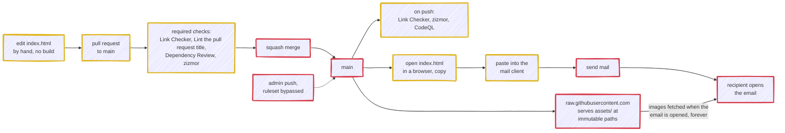
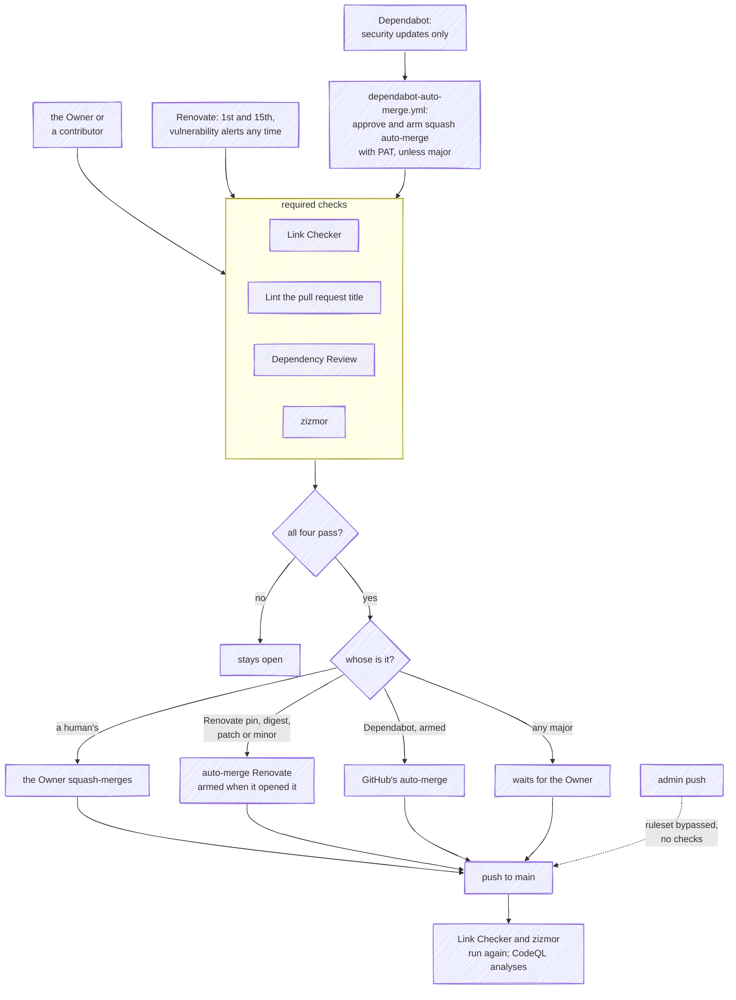
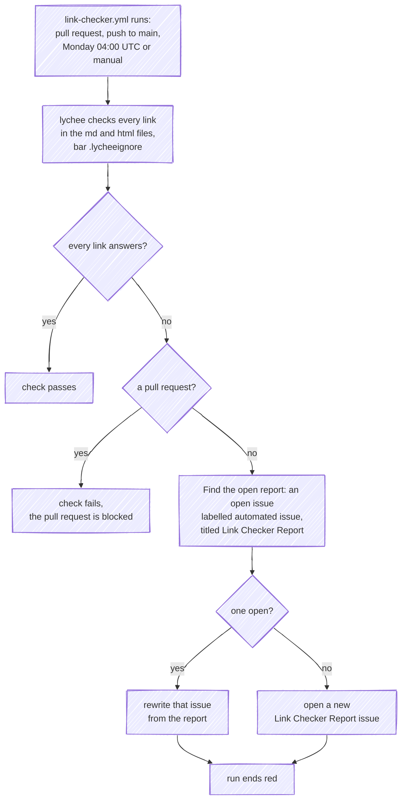

# Architecture

How this repository is put together and why. What it *is* is the [README](./README.md); the vocabulary is
[GLOSSARY.md](./GLOSSARY.md); how to work in it is [AGENTS.md](./AGENTS.md); what a review checks is
[CODING_STANDARDS.md](./CODING_STANDARDS.md). This document does not restate them.

## 1. Two products

There is no application here, so "architecture" means the shape of two artefacts and the obligations
attached to each. They are siblings, neither subordinate to the other
([ADR 0003](./docs/adr/0003-the-signature-and-its-assets-share-one-repository.md)).

| | **The Signature** | **The asset store** |
| --- | --- | --- |
| Is | [`index.html`](./index.html), a single file | [`assets/images/png/`](./assets/images/png), a set of small PNGs |
| Kind | A document, finished when it renders | A service, never finished |
| Consumers | One person, pasting it into a mail client | Every message already sent |
| Contract | None. Rewrite it freely | Paths are permanent ([ADR 0002](./docs/adr/0002-published-asset-paths-are-immutable.md)) |
| Fails by | Rendering wrong in Outlook | A path going missing |
| Failure is visible | Immediately, to the sender | Never, to anyone who can fix it |

That last row is the whole reason the asset store column needs rules. A broken Signature is noticed the first
time it is sent; a broken Published Path is noticed only by strangers reading old mail, who will not report
it.

## 2. The delivery path

Gold is reversible, red is not. The single arrow that makes this repository unusual is the one from `raw`
to `inbox`: it is traversed every time somebody opens an old email, long after the commit that published
the file, and it is the only dependency here that cannot be updated, versioned or deprecated.

The path, start to finish:

1. **An edit.** `index.html` is changed by hand, or an Icon is added under `assets/images/png/`. Nothing
   builds it (§4): the file in the pull request is the file that will be pasted.
2. **A pull request.** The `main` ruleset takes changes only through one, merged by squash, and requires four
   checks to pass first: `Link Checker`, `Lint the pull request title`, `Dependency Review` and `zizmor`
   (§5). It asks for no approval. An admin can skip all of it by pushing to `main` directly, which is still a
   publication.
3. **The merge is the publication.** GitHub raw serves `main` as it stands, so the moment the squash commit
   lands, every Published Path in it is live. The Link Checker and zizmor run again on that push, and CodeQL
   analyses it; none of them can hold it back.
4. **The install.** The Signature is copied out of `index.html` in a browser and pasted into each mail
   client's signature setting, as the [README](./README.md#using-the-signature) walks through. Install after
   the merge, never from a branch: an Icon the copy points at is served only once it is on `main`.
5. **Read time.** Every message sent with that Signature carries the image URLs, not the images. When the
   recipient opens it, their mail client, or the image proxy in front of it, fetches each Icon from GitHub:
   straight from `raw.githubusercontent.com`, or through the redirect behind a `github.com/…/blob/…?raw=true`
   URL ([ADR 0001](./docs/adr/0001-github-raw-serves-the-assets.md)). Until the recipient allows remote
   images, they see the Alt Text instead. The avatar is fetched the same way from
   `avatars.githubusercontent.com`.

Two things in that path catch people out:

- **A new Icon and the first reference to it cannot share a pull request.** The Link Checker on the pull
  request requests the Icon's `main` URL, which does not exist until the merge, so the required check fails.
  The Icon lands in one pull request and the reference in the next.
- **A Published Path that does go missing is repaired by putting the same bytes back at the same path**, from
  the history, in a new commit. That is the one fix that reaches Sent Mail, since every old message still
  quotes that URL; a "better" replacement at a new path repairs nothing already sent.

Consequences follow directly and are worth stating before anything else:

- **A push to `main` is a publication**, and merging a pull request is such a push. There is no deploy step
  to hold anything back ([ADR 0001](./docs/adr/0001-github-raw-serves-the-assets.md)), so an accidental push
  cannot be taken back by reverting it: the URL was live in between.
- **The repository's identity is part of the contract.** Owner, name, default branch and public visibility
  all appear in the published URLs, so renaming, transferring, or making this repository private breaks
  sent mail exactly as deleting a file would.

## 3. The Signature

`index.html` is a single tree of nested `<table role="presentation">` elements with every style written
inline, because that is the only construction a mail client can be trusted with
([ADR 0004](./docs/adr/0004-email-clients-dictate-the-markup.md)). Read as a web page it is indefensible;
it is not a web page.

Its structure, top to bottom:

The wrapper table (`width="550"`) holds everything in a stack of rows, fixed width because mail clients do
not do responsive reliably. Its first row is a two-cell block; the rows under it are full-width bands.

| Region | Holds |
| --- | --- |
| Row 1, left cell | The avatar, 120px, circular via `border-radius`, fetched from GitHub's avatar service |
| Row 1, right cell | A stack of nested rows: name; role and employer, with a `border-bottom` acting as a rule; then phone and personal site, the two labelled Contact Links |
| Row 2 | The social Contact Links, each an icon-only `<a>` in its own cell |
| Row 3 | The GitHub link: a labelled Contact Link built as two cells on a dark background, icon then text, rather than as adjacent ``s |
| Row 4 | The confidentiality notice, in English and Spanish |

Every `` carries an `alt`, and that is load-bearing rather than polite: mail clients block remote
images by default, so the Alt Text is what most recipients see first, and it is the entire fallback if the
assets ever stop being served.

The avatar is the one image **not** served from this repository. It comes from
`avatars.githubusercontent.com`, so it changes whenever the GitHub profile picture changes, without a
commit here. That is convenient and entirely outside this repository's control.

The repository's own icons are referenced in two different URL forms: the social ones and the GitHub link's via a
`github.com/…/blob/…?raw=true` redirect, the phone and website ones directly from `raw.githubusercontent.com`. Both are
published and neither can now be changed ([ADR 0001](./docs/adr/0001-github-raw-serves-the-assets.md)).

## 4. There is no build

`index.html` is source and artefact at once. No generator, no template, no inliner, no package manager, no
lockfile, no dependencies; cloning gives a complete working copy, and the only "build" is opening the file
([ADR 0005](./docs/adr/0005-no-build-step.md)).

The Preview, [`assets/images/output/index.png`](./assets/images/output/index.png), is likewise a hand-taken screenshot uploaded by hand. It is
shown in the README and nothing checks that it still matches the Signature; keeping it in step is a human
obligation, recorded in [AGENTS.md](./AGENTS.md). It has not been honoured since the start: the Preview has a
single commit, the one that first brought the Signature in, and every later edit to `index.html` has left it
untouched. Two of those edits balanced tags, and the third gave the disclaimer band's padding the unit the
browser the Signature is copied from had already been assuming, so the drift may be nil, but whether it is
cannot be known from here, which is the point of the obligation.

Correctness here cannot be automated in any case. "Renders in Outlook" is not a property any generator
produces or any CI step asserts, so the only real test is sending the thing to a real client.

## 5. Automation

The workflows carry no build among them. Every third-party action is pinned to a commit SHA with the version
as a trailing comment, and updated by Renovate under an automerge policy graded by blast radius
([ADR 0007](./docs/adr/0007-actions-are-pinned-by-digest-and-auto-merged.md)).

| Workflow | Trigger | Does |
| --- | --- | --- |
| [`link-checker.yml`](./.github/workflows/link-checker.yml) | push to `main`, pull request, Mondays at 04:00 UTC (`0 4 * * 1`), manual | Runs lychee with `fail: true` over every `*.md` and `*.html` file. On a pull request a broken link only fails the check; anywhere else it opens the *Link Checker Report* issue from the report, or updates the one already open, so a link that keeps failing is one issue. The weekly run catches a link that dies with nothing pushed. The only check on the delivery path |
| [`zizmor.yml`](./.github/workflows/zizmor.yml) | push to `main`, any pull request | Statically audits the workflow files themselves and uploads the findings to code scanning, which reports them as the `zizmor` check; `permissions: {}` at top level, narrowed per job |
| [`commit-message.yml`](./.github/workflows/commit-message.yml) | pull request opened/edited/reopened/synchronised | Lints the pull request title against conventional commits, which is the message a squash merge commits; a pinned action does it, since there is no toolchain here to run commitlint |
| [`dependency-review.yml`](./.github/workflows/dependency-review.yml) | every pull request | Fails a pull request that introduces an action with a known vulnerability; the actions are this repository's whole supply chain, and the dependency graph reads them from the `uses:` lines, recorded by commit SHA |
| [`dependabot-auto-merge.yml`](./.github/workflows/dependabot-auto-merge.yml) | pull request opened/synchronised, acting only when Dependabot opened it | Approves and arms a squash auto-merge, with `PAT`, for Dependabot patch/minor updates, and dev/indirect ones short of a major; comments on a major instead. Labels each update by type: `patch-update` and `auto-merge`, `minor-update`, or `major-update` and `review-required` |

CodeQL runs here too, through GitHub's **default setup** rather than a workflow in the tree. It analyses the
`actions` language on pushes to `main`, on pull requests and once a week, and reports as the `CodeQL` check,
which the ruleset does not require. Nothing in this repository configures it; it is switched on and off in
the repository's code-scanning settings.

### Checks and merges

Every change reaches `main` through a pull request, bar an admin's direct push, and every pull request has
to pass the same four required checks whoever opened it. What happens after they pass depends on who that was:

- **Renovate needs no credential here.** The ruleset requires no approval, only the checks, so when Renovate
  opens a pull request whose update type its config automerges, it switches on GitHub's squash auto-merge
  there and then, and GitHub merges it the moment the checks pass. A major is labelled `major-update` and
  left for the Owner ([ADR 0007](./docs/adr/0007-actions-are-pinned-by-digest-and-auto-merged.md)).
- **A dead external link blocks every pull request, Renovate's included.** `Link Checker` is a required
  check and lychee reads every link in the tree, not only the ones a pull request touched, so one link that
  dies anywhere fails the check on every open pull request and Renovate's automerge stalls repository-wide.
  The way out is to fix or drop the link, or, for a host that only refuses bots, to add it to
  [`.lycheeignore`](./.lycheeignore) with the reason in the commit; the pull request doing that is the one
  that turns the check green again.
- **The Dependabot merge is the Owner's, through `PAT`, and `PAT` has to be stored twice.** A workflow run
  started by a Dependabot pull request gets no Actions secrets, only the repository's **Dependabot** secrets,
  so `PAT` must exist in both stores (Settings → Secrets and variables → Actions, and → Dependabot) with the
  same value. Nothing watches its expiry: the first sign is a red *Approve and auto-merge* step on a
  Dependabot pull request that then sits open. To rotate it, create the new token on the Owner's account and
  update `PAT` in both stores before revoking the old one.

### The link checker's decision

On a pull request the failed check is the whole report, so no issue is written; everywhere else the issue is
the record. Nothing closes it when the links recover: it stays open until the Owner closes it, and
the next failure after that opens a fresh one. A concurrent run on the same pull request cancels the one in
progress; runs on `main` queue instead.

The schedule has its own way of stopping. In a public repository GitHub **disables scheduled workflows after
60 days with no repository activity**, and here the activity is mostly Renovate's merges, which only happen
when an action has a new release. A quiet two months switches the Monday run off with no failure anywhere;
the workflow page in the Actions tab then offers to enable it again, and until someone does, a link that
dies is caught only by the next pull request.

[`.lycheeignore`](./.lycheeignore) exempts a handful of hosts (Reddit, Medium, Unsplash and LinkedIn) because they defend against
bots and answer CI with `403` or another `4xx`. Those links are therefore never verified at all: if one
dies for real, nothing notices. It also exempts this repository's own assets in the
`github.com/…/blob/main/assets/` form, which github.com answers with `503` when lychee asks for several at
once; the assets are still verified through their `raw.githubusercontent.com` URLs.

Renovate is the bot doing the work ([`.github/renovate.json`](./.github/renovate.json): digest pinning, a four-day `minimumReleaseAge`,
runs on the 1st and 15th, vulnerability alerts at any time). Dependabot has an auto-merge workflow but **no
`.github/dependabot.yml`**, so it raises only the security updates GitHub creates on its own.

## 6. Decision records

The documents above are **what** and **how**. [docs/adr/](./docs/adr/) is **why**:

| ADR | Decision |
| --- | --- |
| [0001](./docs/adr/0001-github-raw-serves-the-assets.md) | GitHub raw serves the assets |
| [0002](./docs/adr/0002-published-asset-paths-are-immutable.md) | Published asset paths are immutable |
| [0003](./docs/adr/0003-the-signature-and-its-assets-share-one-repository.md) | The Signature and its assets share one repository |
| [0004](./docs/adr/0004-email-clients-dictate-the-markup.md) | Email clients dictate the markup |
| [0005](./docs/adr/0005-no-build-step.md) | No build step |
| [0006](./docs/adr/0006-cc0-1-0-licence.md) | CC0-1.0 licence (superseded by 0008) |
| [0007](./docs/adr/0007-actions-are-pinned-by-digest-and-auto-merged.md) | Actions are pinned by digest and auto-merged |
| [0008](./docs/adr/0008-mit-replaces-the-cc0-dedication.md) | MIT replaces the CC0-1.0 dedication |

Every one of them follows [0000, the template](./docs/adr/0000-adr-template.md): `# N. Title`, a date, a
status, then *Context*, *Decision*, *Consequences*. A new ADR starts by copying that file, not by writing
one from scratch, and is written only when the decision is **hard to reverse**, **surprising without
context** and **the result of a real trade-off**.

| Document | Covers |
| --- | --- |
| [README.md](./README.md) | What this is, the Preview, and how to install the Signature in a mail client |
| [GLOSSARY.md](./GLOSSARY.md) | Domain vocabulary, split into the two contexts of §1 |
| [ARCHITECTURE.md](./ARCHITECTURE.md) | This file: the two products, the delivery path, the checks and merges, the ADR index |
| [AGENTS.md](./AGENTS.md) | Working rules, the maintenance contract, gotchas |
| [CODING_STANDARDS.md](./CODING_STANDARDS.md) | How the markup and the assets are written: what a review checks a diff against |
| [docs/adr/](./docs/adr/) | Why each irreversible decision was made, and what it cost |
