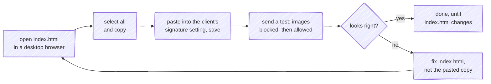

# Email signature
This repo holds the base code of my email signature and the icons it shows, which GitHub serves straight out of it. It is not a CDN, just a public repository ([ADR 0001](./docs/adr/0001-github-raw-serves-the-assets.md)). This is the result:

## Related actions

## Using the signature

A mail client keeps its own copy of whatever is pasted into its signature setting, and that copy is what every
message carries. Nothing installs or updates it for you.

1. **Open [`index.html`](./index.html) in a desktop browser**, straight from a checkout of `main`, and wait for
   the icons to load. They are remote images, so the copy only carries them once the page has fetched them.
2. **Select everything on the page and copy it** (Ctrl+A then Ctrl+C, or ⌘A then ⌘C on a Mac). The clipboard
   takes the rendered tables with their inline styles and the image URLs, which is what a signature editor
   accepts.
3. **Paste it into the signature setting of each client you send from**, and save. Where that setting lives:

   | Client | Where the signature lives |
   | --- | --- |
   | Gmail on the web | Settings → *See all settings* → *General*, in the *Signature* section. Create one, paste into its box, choose it as the default for new mail and for replies, and save the page. |
   | Outlook for Windows (classic) | *File* → *Options* → *Mail* → *Signatures*. The signature is stored on that computer only. |
   | New Outlook for Windows, Outlook on the web | Settings, on the *Signatures* page of the account settings. |
   | Apple Mail on macOS | Mail → *Settings* (*Preferences* on older macOS) → *Signatures*. Untick *Always match my default message font*, or Mail swaps the signature's fonts for its own. |
   | Mail on iPhone and iPad | The Settings app, in Mail's settings, under *Signature*. It is set per device and does not come over from a Mac. Paste a copy taken on the device, for example from a test message you sent yourself; how much of the table layout the field keeps varies, so check it with a test sent from the device. |

4. **Send a test to an Outlook and a Gmail address and read it twice:** once with remote images blocked, where
   the Alt Text has to stand in for every icon, and once with them allowed.

Two rules keep the copies honest:

- **Never edit a link, a number or any text in the client's own editor.** The editor rewrites the markup
  around whatever it touches (Outlook's is Word's), and the change lives in that one client only. Edit
  `index.html` and paste again.
- **Install again after any change to `index.html`.** A pasted signature is a copy taken at paste time, so
  every client keeps sending the old one until it is replaced. A changed icon is a new image path
  ([ADR 0002](./docs/adr/0002-published-asset-paths-are-immutable.md)), so an old copy keeps showing the old icon too.

## Documentation

Before changing anything under `assets/`, read [ADR 0002](./docs/adr/0002-published-asset-paths-are-immutable.md):
those paths are quoted by every email already sent, so they are never renamed or deleted.

- [ARCHITECTURE.md](./ARCHITECTURE.md): the two products, the delivery path, the checks and merges, and the index of decisions
- [GLOSSARY.md](./GLOSSARY.md): domain vocabulary
- [AGENTS.md](./AGENTS.md): working rules, maintenance contract and gotchas
- [CODING_STANDARDS.md](./CODING_STANDARDS.md): how the markup and the assets are written, checked at review
- [CONTRIBUTING.md](./CONTRIBUTING.md): what kind of contribution fits, and how to send one
- [SECURITY.md](./SECURITY.md): how to report a link or an asset that could harm a recipient
- [docs/adr/](./docs/adr/): why each irreversible decision was made, and what it cost

## License

[MIT](./LICENSE) © Ferran Buireu. The third-party marks under [`assets/images/png/`](./assets/images/png) belong to their owners and are not covered by it ([ADR 0008](./docs/adr/0008-mit-replaces-the-cc0-dedication.md)).
